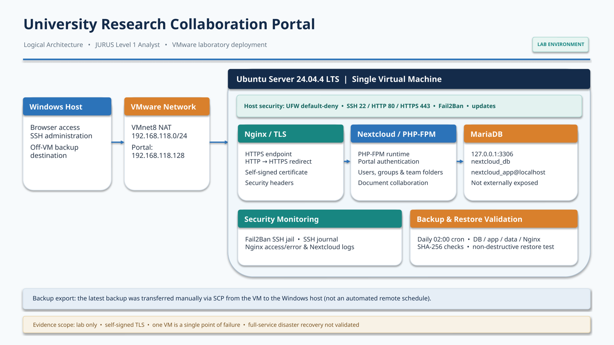
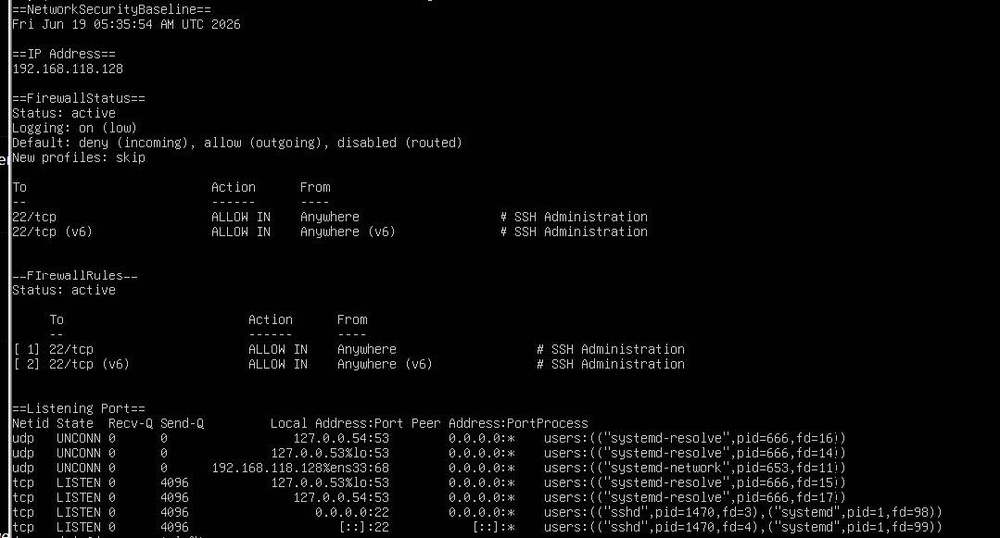
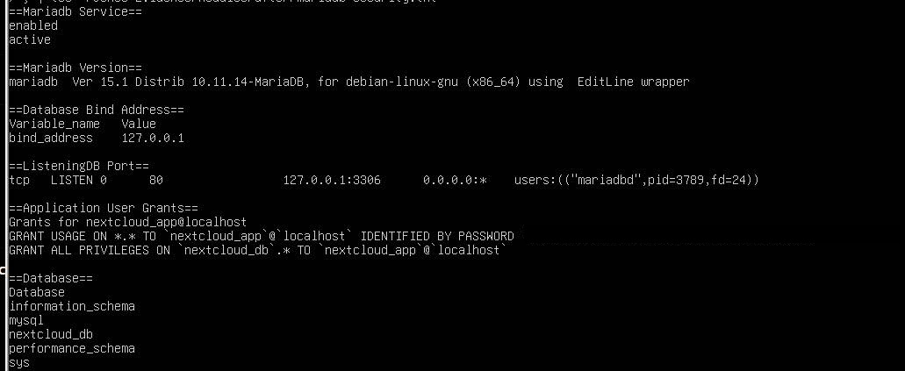
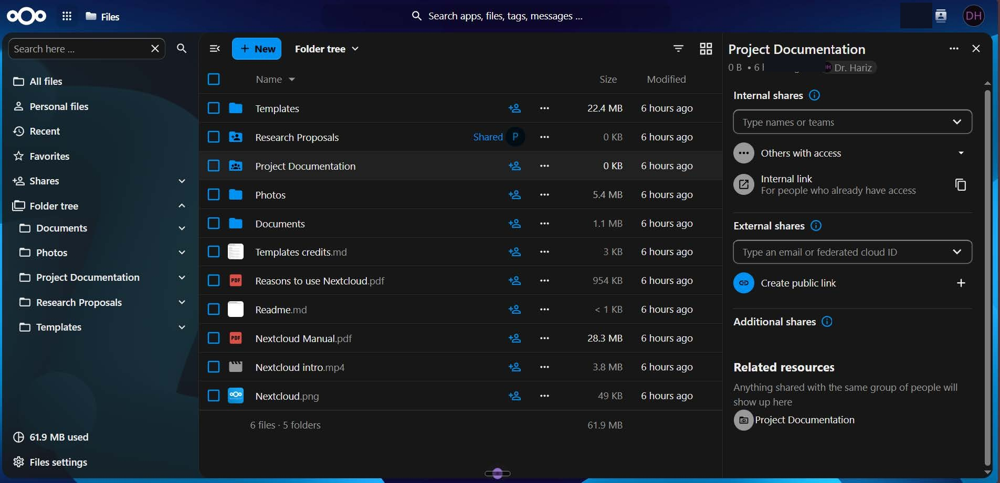
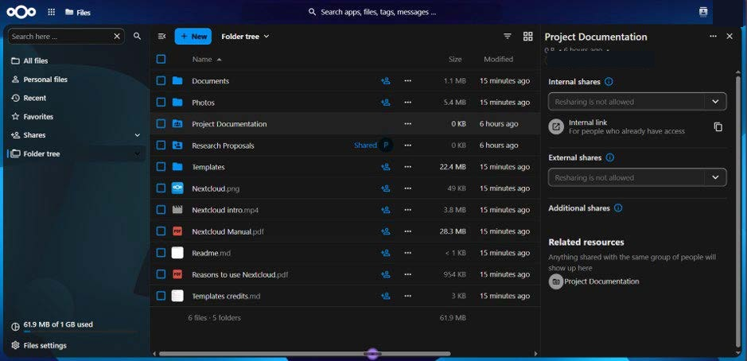
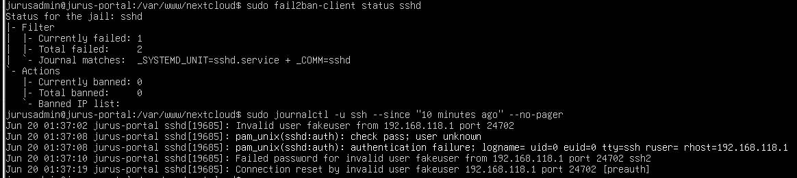
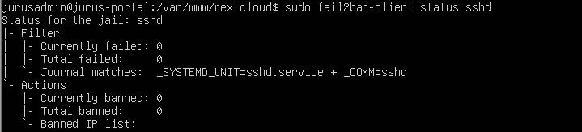

# JURUS Level 1 Analyst — University Research Collaboration Portal

> Cybersecurity infrastructure and security-validation project completed for the **JURUS Level 1 (Analyst) Cyber Engineering Challenge (2026)**.
>
> **Environment:** VMware Workstation / Ubuntu Server 24.04.4 LTS (private laboratory network)
>
> **Project type:** Practical assessment / proof of concept — **not a production deployment**.

## Project overview

This project demonstrates the deployment and security hardening of a university research collaboration portal. I used **Nextcloud** rather than developing a custom application so that I could focus on infrastructure configuration, access controls, service security, monitoring, and recovery testing.

The portal supports user and group management, controlled research-document sharing, collaboration requests, and announcements.

## System Architecture

The project was deployed in a private VMware laboratory environment using a single Ubuntu Server virtual machine.

## Technology stack

- **Infrastructure:** VMware Workstation, Ubuntu Server, VMnet8 NAT
- **Web and application:** Nginx, HTTPS/TLS, PHP-FPM, Nextcloud
- **Database:** MariaDB
- **Host and network security:** UFW, OpenSSH, Fail2Ban
- **Monitoring:** SSH/system journals, Nginx logs, Nextcloud activity records
- **Backup and validation:** Bash, cron, `mariadb-dump`, tar/gzip, SHA-256
- **Security assessment:** Nmap, OpenSSL, Nikto; the project report also contains an OWASP ZAP passive-scan section

## Implemented work

1. **Operating-system engineering:** configured an Ubuntu server, reviewed services and administrative privileges, and applied security updates.
2. **Network security:** applied a default-deny inbound firewall policy, restricted exposed services, configured HTTPS and HTTP-to-HTTPS redirection, and reviewed SSH security.
3. **Database security:** configured MariaDB to listen on localhost and created a database-specific Nextcloud application account.
4. **Application security:** configured role-based users and team folders for researchers, postgraduate students, and industry partners.
5. **Security monitoring:** enabled a Fail2Ban SSH jail and examined authentication, web-access, and application activity logs.
6. **Business continuity:** generated backups covering the database, application, uploaded data, and Nginx configuration; created checksums and conducted a **non-destructive restore validation**.

## Selected validation evidence

| Area | Recorded observation |
|---|---|
| Exposed services | SSH (22), HTTP redirect (80), HTTPS (443) |
| Database exposure | MariaDB restricted to localhost; remote port 3306 not directly accessible in the lab |
| Transport security | TLS 1.0/1.1 rejected; TLS 1.2/1.3 accepted |
| Backup execution | One recorded backup completed in 42 seconds |
| Restore validation | 144 database tables restored into a separate test database, with archive extraction and sample-file checks |
| Restore validation time | 17 seconds in the recorded laboratory test |

**Important:** The 17-second result is the duration of a *non-destructive validation*, **not** a measured full-disaster recovery time. A complete restoration of the server and operational portal has not been established by this evidence. The 30-minute RTO is a **target**, not a demonstrated end-to-end recovery result.

## Known limitations and further work

- All major components run on a single VM; this is not a high-availability deployment.
- HTTPS uses a self-signed certificate appropriate for the isolated lab, not a publicly trusted production certificate.
- SSH password authentication remained enabled in the lab.
- The latest backup was copied outside the VM **manually**; recurring off-VM protection is not yet proven.
- A full-disaster restoration test (rebuilding a replacement VM and bringing the portal back online) remains to be demonstrated.
- Enforced MFA, centralized monitoring, automated encrypted remote backups, and additional administrative hardening are future improvements.

## Evidence and documentation

The original technical report contains implementation screenshots and test evidence. A reviewed public version may be published after correcting the backup/recovery wording and removing any potentially sensitive authentication, configuration, or assessment information.

## Implementation evidence

Selected screenshots were captured in the JURUS Level 1 Analyst VMware laboratory. Authentication hashes and identifiable account labels have been redacted from the published copies.

### UFW initial firewall baseline

The baseline screenshot shows an active default-deny inbound policy with SSH (22/tcp) allowed. This is **not** evidence of the later HTTP/HTTPS firewall configuration.

### MariaDB security

MariaDB is bound to `127.0.0.1:3306`, with a dedicated `nextcloud_app@localhost` user scoped to `nextcloud_db`. The authentication hash has been redacted.

### Nextcloud access-control examples

The lab portal shows research and student account views of research collaboration folders. Screenshots document interface and folder visibility, **not by themselves a comprehensive permission test**.

### SSH monitoring with Fail2Ban

The first screenshot shows an enabled SSH jail alongside an invalid-user authentication event in the SSH journal. The counters show failed attempts but **zero currently banned addresses**, so this demonstrates detection/logging rather than a successful ban.

A separate initial status screenshot recorded zero failed and zero banned addresses.

> These images are evidence from a private lab environment, not proof of a production-grade deployment.

## Lessons learned

The project strengthened my practical understanding of Linux administration, secure service configuration, least-privilege access, security validation, and the important distinction between **having a backup**, **validating backup data**, and **recovering an entire working service**.

---

*This repository documents a training/assessment environment. Do not treat the demonstrated lab configuration as a ready-to-deploy production template.*
